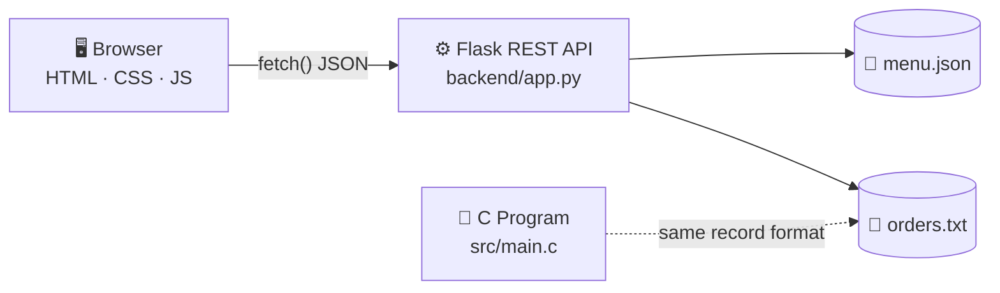

<div align="center">

# 🍽️ SmartServe

### Restaurant Management System using Data Structures & Algorithms

*Take an order → send it to the kitchen queue → generate the bill. All in one place.*


**B.Tech Mini Project** · Runs locally · Payments are demo only

</div>

---

## ⚡ In 30 Seconds

| | |
|---|---|
| **What is it?** | A restaurant web app (menu, orders, kitchen queue, billing, history) plus a C program that shows how DSA works on the same order data. |
| **Web app** | HTML + CSS + JavaScript frontend talking to a Python Flask REST API. |
| **DSA part** | Queue, Stack, Linked List and Binary Search Tree written in C (`src/main.c`). |
| **Storage** | Simple files: `data/menu.json` and `data/orders.txt`. |

## 🗺️ How It Works



> The C program runs separately. Flask does not call it; both just use the same `orders.txt` format.

## ✨ Features

| | Feature | What it does |
|:--:|---|---|
| 📊 | **Dashboard** | Total / pending / processed orders, order value, recent orders |
| 🍛 | **Food Menu** | View items and **add new food items** (saved to `menu.json`) |
| 🧾 | **Orders** | Pick an item and quantity; the server calculates the total |
| 👨‍🍳 | **Kitchen Queue (FIFO)** | Oldest pending order is processed first |
| 💳 | **Billing** | Subtotal + sample 5% GST; choose Cash / UPI / Card *(demo only)* |
| 📜 | **Order History** | All orders with Pending / Processed status |
| 🧠 | **DSA Lab** | Visual view of queue, stack and linked list |

> 💡 **Payments are a demo.** The chosen method is only kept in the browser page. No real payment is processed and no payment gateway is connected.

## 📸 Screenshots

<table>
  <tr>
    <td width="50%" valign="top">
      <b>🏠 Home Dashboard</b><br>
      <br>
      <sub>Stats, recent orders, quick actions</sub>
    </td>
    <td width="50%" valign="top">
      <b>🍛 Food Menu</b><br>
      <br>
      <sub>Menu items + add-food form</sub>
    </td>
  </tr>
  <tr>
    <td width="50%" valign="top">
      <b>💳 Billing</b><br>
      <br>
      <sub>Bill with GST and payment method (demo)</sub>
    </td>
    <td width="50%" valign="top">
      <b>👨‍🍳 Kitchen Queue</b><br>
      <br>
      <sub>Pending orders in FIFO order</sub>
    </td>
  </tr>
  <tr>
    <td width="50%" valign="top">
      <b>📜 Order History</b><br>
      <br>
      <sub>Every order with its status</sub>
    </td>
    <td width="50%" valign="top">
      <b>🧠 DSA Lab / Full Dashboard</b><br>
      <br>
      <sub>Queue, stack, linked list, order search</sub>
    </td>
  </tr>
</table>

## 🧠 Where DSA Is Used

All implemented in **`src/main.c`**.

| Data Structure | Real use in SmartServe | Key functions |
|---|---|---|
| 🚶 **Queue (FIFO)**, circular array | Kitchen cooks the oldest order first | `enqueue()` `dequeue()` |
| 📚 **Stack (LIFO)** | See the most recent orders on top | `push_order_index()` `pop_order_stack()` |
| 🔗 **Linked List** | Orders chained in arrival order | `list_append()` `display_linked_list()` |
| 🌳 **Binary Search Tree** | Search orders by ID, list them sorted | `bst_insert()` `bst_search()` |
| 🔍 **Searching** | Find a food item or an order | `find_food()` |
| 📶 **Sorting** | Menu sorted by price (insertion sort) | `sort_food_menu()` |
| 💾 **File Handling** | Load / save orders | `load_orders()` `save_orders()` |

<details>
<summary><b>🖥️ All options in the C console menu</b></summary>

1 Display menu · 2 Place order · 3 View kitchen queue · 4 Table booking · 5 Billing · 6 Search food · 7 Sort menu by price · 8 Process next order · 9 Order history · 10 Linked list display · 11 Linked list search · 12 Show stack · 13 Peek stack · 14 Pop stack · 15 BST display · 16 BST search · 0 Save and exit

</details>

## 🚀 Quick Start (Windows PowerShell)

Run everything from the project root folder.

**1️⃣ Get the code**
```powershell
git clone https://github.com/atul-nandanwar/SmartServe-Restaurant-Management-System1.git
cd SmartServe-Restaurant-Management-System1
```

**2️⃣ Start the backend**
```powershell
python -m venv .venv
.\.venv\Scripts\Activate.ps1
python -m pip install -r backend/requirements.txt
python backend/app.py
```
Backend runs at `http://127.0.0.1:5000`. Keep this window open.

> If PowerShell blocks activation, run `Set-ExecutionPolicy -Scope Process -ExecutionPolicy Bypass` and activate again.

**3️⃣ Open the frontend**

Open the folder in VS Code, right-click `frontend/index.html` → **Open with Live Server**.
No Live Server? Use a second PowerShell window:
```powershell
python -m http.server 5500 --directory frontend
```
then open `http://127.0.0.1:5500/index.html`.

✅ The top-right pill shows **Live System** when the frontend is connected to the backend.

**4️⃣ (Optional) Run the C program**
```powershell
.\main.exe
```
Recompile with `gcc src/main.c -o main.exe` (GCC needed). Always run it from the project root.

## 🔌 API Cheat Sheet

| Method | Endpoint | Purpose |
|:--:|---|---|
| GET | `/` | API status message |
| GET | `/api/health` | Health check |
| GET | `/api/menu` | List menu items |
| POST | `/api/menu` | Add a food item (`name`, `price`, optional `desc`) |
| GET | `/api/orders` | List orders with counts |
| POST | `/api/orders` | Create an order (`foodId`, `quantity` 1–100) |
| POST | `/api/orders/process-next` | Process the oldest pending order |
| GET | `/api/orders/<order_id>` | Get one order |

## 📁 Project Structure

<details>
<summary><b>Click to expand</b></summary>

```text
SmartServe-Restaurant-Management-System1/
├── backend/
│   ├── app.py              # Flask REST API
│   └── requirements.txt    # Flask, Flask-Cors
├── data/
│   ├── menu.json           # Menu items
│   └── orders.txt          # Orders: order_id food_id quantity total processed
├── frontend/
│   ├── index.html
│   ├── style.css
│   └── app.js
├── Screenshot/             # README images
├── src/
│   └── main.c              # C DSA program
├── main.exe                # Compiled C program (Windows)
└── README.md
```

</details>

## ⚠️ Good To Know

<details>
<summary><b>Current limitations (click to expand)</b></summary>

- The web app and the C program are **not connected**; they only share the `orders.txt` format.
- The C program has a fixed menu of **6 items**. Orders for food added later through the web app are skipped when it loads and are removed when it saves. **Back up `data/` first** and do not run both at the same time.
- Payment choice is **demo only** and is lost on page refresh. GST is illustrative.
- Each order has **one item** with a quantity. Maximum **100 orders**.
- Runs on a local development server with no login. **Not deployed online.**
- The DSA Lab page is a visual demo; the real data structures are in the C code.

</details>

## 🔮 Roadmap

*Planned ideas, not yet implemented.*

- [ ] SQLite / MySQL database
- [ ] Save payment records + real payment gateway
- [ ] Multiple items per order, edit/delete menu items
- [ ] One shared menu for the C program and web app
- [ ] Login for staff and admin
- [ ] Sales reports
- [ ] Automated tests and online deployment

## 🎓 What We Learned

- Building a queue, stack, linked list and BST in C
- File handling and searching / sorting algorithms
- Designing REST APIs with validation in Flask
- Connecting a JavaScript frontend to a backend
- Teamwork with Git and GitHub

## 👥 Team

| # | Member |
|:--:|---|
| 1 | **Atul Nandanwar** |
| 2 | **Ishan Jaiswal** |
| 3 | **Sai Pohekar** |
| 4 | **Om Pande** |
| 5 | **Ashwini Goswami** |

🔗 **Repository:** [github.com/atul-nandanwar/SmartServe-Restaurant-Management-System1](https://github.com/atul-nandanwar/SmartServe-Restaurant-Management-System1)

## 📄 License

No license file is included yet, so no license is granted for reuse or redistribution. Add a `LICENSE` file if you want others to reuse the code.